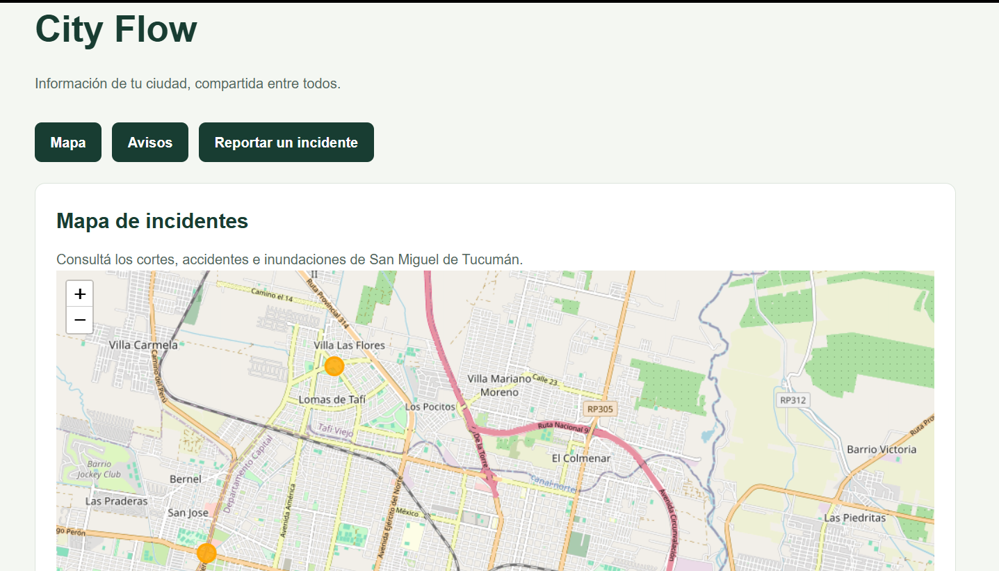

# City Flow

Proyecto web del Taller Integrador II - 2026. La aplicación permite consultar
avisos de cortes, accidentes e inundaciones en una lista y en un mapa, y cargar
nuevos reportes.

## Tecnologías

- React y Vite para la aplicación web.
- Supabase y PostgreSQL para guardar los reportes.
- Leaflet para mostrar el mapa.

## Ejecutar el proyecto

Instalar las dependencias y arrancar el servidor local:

```bash
npm install
npm run dev
```

## Base de datos (Supabase)

La estructura de la tabla `public.incidentes` y sus permisos están en
[`supabase/migrations/20261102000000_create_incidentes.sql`](supabase/migrations/20261102000000_create_incidentes.sql).
La migración crea el ID y la fecha automáticamente, valida los tipos permitidos,
la referencia y las coordenadas, y activa RLS. La aplicación puede consultar y
crear incidentes; no puede modificarlos ni borrarlos.

Para cargar reportes ficticios en un proyecto vacío, ejecutar una sola vez
[`supabase/seed.sql`](supabase/seed.sql). No volver a ejecutarlo en una base que
ya tenga esos ejemplos para evitar duplicados.

La conexión de React usa la URL del proyecto y la clave pública de Supabase.
Guardarlas en variables locales de entorno y no subirlas al repositorio. Nunca
compartir la contraseña de la base ni la clave `service_role`.


## Integrantes

- Paulina Carignani
- Josefina Beale
- Julieta Lamas
- Ana Paula Quintana
- Ana Paula Gallardo
- Guadalupe Perez Frías
- Milena Godoy Char

## Instalación y configuración desde cero

### Requisitos

- Node.js con npm.
- Conexión a internet.
- URL y clave publicable del proyecto Supabase del equipo.

### Descargar el proyecto

En GitHub, seleccionar Code → Download ZIP y extraer el archivo.
Abrir en Visual Studio Code la carpeta que contiene package.json.

También puede descargarse mediante Git:

```bash
git clone https://github.com/paulinacarignani/city-flow.git
cd city-flow
```

### Instalar las dependencias

Abrir una terminal en la carpeta del proyecto y ejecutar:

```bash
npm ci
```

En Windows, si PowerShell bloquea npm.ps1, usar:

```powershell
npm.cmd ci
```

### Configurar Supabase

Copiar .env.example y nombrar la copia .env.local.
Completar las variables con los datos del proyecto:

```dotenv
VITE_SUPABASE_URL=
VITE_SUPABASE_PUBLISHABLE_KEY=
```

Solicitar esos valores a la responsable de la conexión.
No usar la contraseña de la base ni la clave service_role.
No subir .env.local al repositorio.

Si se utiliza un proyecto Supabase nuevo, ejecutar primero
supabase/migrations/20261102000000_create_incidentes.sql
y después supabase/seed.sql.

Si se utiliza la base ya configurada del equipo, confirmar
con su responsable qué scripts están aplicados antes de ejecutarlos.
Repetir el seed puede duplicar los datos de ejemplo.

### Ejecutar la aplicación

```bash
npm run dev
```

En PowerShell puede utilizarse:

```powershell
npm.cmd run dev
```

Abrir la dirección indicada en la terminal, normalmente
http://localhost:5173/.

Mantener la terminal abierta mientras se utiliza la aplicación.
Si cambia .env.local, reiniciar el servidor de desarrollo.

La aplicación no requiere una cuenta de usuario.
Se necesita internet para Supabase y el fondo del mapa.

## Funciones de la versión actual

- Crear reportes de cortes, accidentes e inundaciones.
- Seleccionar la ubicación en un mapa.
- Validar los campos obligatorios.
- Guardar una descripción opcional de hasta 500 caracteres.
- Consultar reportes en lista y mapa.
- Abrir la información desde un marcador.
- Conservar los reportes al reiniciar el frontend.

## Funciones pendientes

- Filtros por tipo o zona.
- Fotografías.
- Notificaciones al celular.
- Estado de resolución de los reportes.
- Búsqueda por zona y cálculo de rutas.

## Documentación

- [Manual de usuario](docs/manual-usuario.md)
- [Registro de pruebas](docs/pruebas.md)
- [Antecedentes y conclusiones](docs/proyecto.md)
- [Diseño de la base de datos](docs/diseno-bd.md)

## Captura de la aplicación



## Uso de inteligencia artificial

Utilizamos ChatGPT como apoyo para definir el nombre y el boceto
inicial, comprender conceptos, organizar la documentación,
preparar casos de prueba y revisar el proyecto.

Los resultados funcionales registrados por Milena corresponden
a las pruebas realizadas en su computadora.