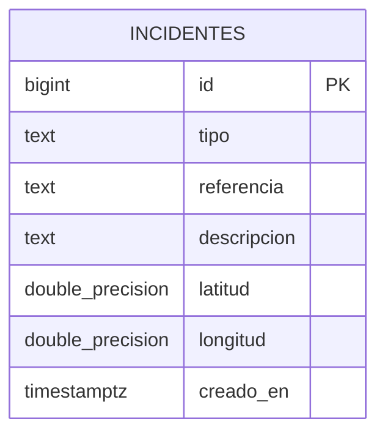

# Diseño de la base de datos

City Flow utiliza PostgreSQL mediante Supabase.

## Tabla incidentes

Guarda los reportes ciudadanos con su tipo, referencia,
descripción, ubicación y fecha de carga.

| Campo | Tipo | Qué guarda |
|---|---|---|
| id | bigint | Identificador único generado automáticamente |
| tipo | text | corte, accidente o inundacion |
| referencia | text | Calle, esquina o lugar del incidente |
| descripcion | text | Información adicional opcional |
| latitud | double precision | Coordenada de latitud |
| longitud | double precision | Coordenada de longitud |
| creado_en | timestamptz | Fecha y hora de carga generadas automáticamente |

## Diagrama

Esta versión utiliza una sola tabla, sin relaciones con otras tablas.

## Restricciones definidas en el script

- El tipo debe ser corte, accidente o inundacion.
- La referencia es obligatoria y debe tener entre 3 y 150
  caracteres después de quitar los espacios externos.
- La descripción es opcional y admite hasta 500 caracteres.
- La latitud es obligatoria y debe estar entre -90 y 90.
- La longitud es obligatoria y debe estar entre -180 y 180.
- El identificador y la fecha se generan en la base.

## Acceso a los datos

El script activa Row Level Security y define políticas
para consultar y crear incidentes.

No define políticas para modificar o eliminar reportes
desde la aplicación.

La comprobación de los permisos y restricciones en la
base real queda pendiente con las responsables de Supabase.

## Archivos SQL

Estructura y permisos:
supabase/migrations/20261102000000_create_incidentes.sql

Datos ficticios de ejemplo:
supabase/seed.sql## Imagen del diagrama

