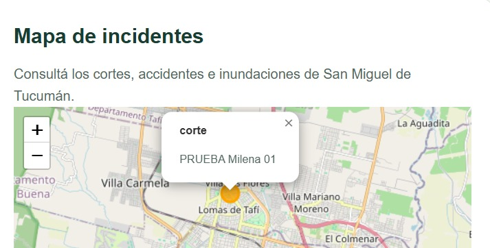
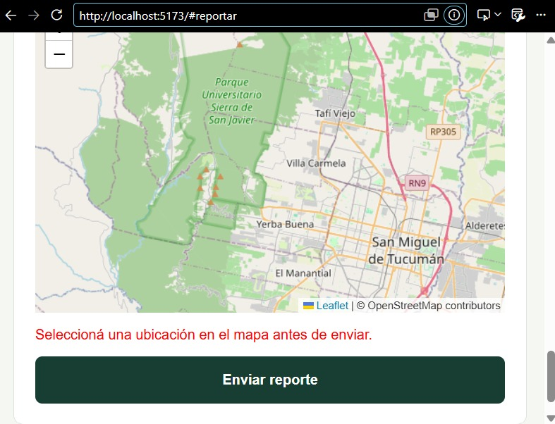
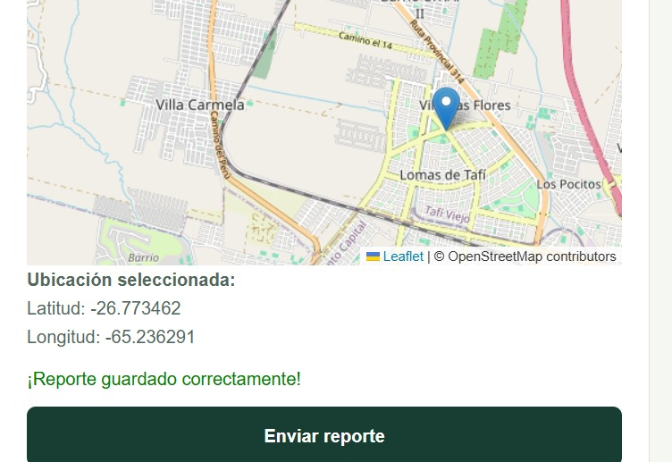

# Manual de usuario de City Flow

City Flow permite consultar y reportar cortes, accidentes e inundaciones.
Para utilizarla se necesita conexión a internet.

## Consultar reportes

1. Abrir la aplicación.
2. Ir a Avisos para consultar los reportes registrados.
3. Cada reporte muestra el tipo, la referencia, la descripción
   cuando existe y la fecha de carga.

## Consultar el mapa

1. Ir a Mapa.
2. Buscar los círculos que representan los incidentes.
3. Los cortes aparecen en naranja, los accidentes en rojo
   y las inundaciones en azul.
4. Hacer clic en un círculo para consultar su información.

## Crear un reporte

1. Ir a Reportar un incidente.
2. Seleccionar el tipo de incidente.
3. Completar Referencia con entre 3 y 150 caracteres.
4. Agregar una descripción opcional de hasta 500 caracteres.
5. Hacer clic en el mapa del formulario para seleccionar la ubicación.
6. Presionar Enviar reporte una sola vez.
7. Esperar la confirmación de guardado.
8. Consultar el nuevo reporte en la lista y en el mapa.

## Validaciones

La referencia y la ubicación son obligatorias.
Una referencia formada solo por espacios no es válida.
La descripción puede quedar vacía.

Si falta un dato obligatorio, el formulario impide el envío
y señala qué debe completarse.

## Actualizar la información

Después de guardar, la aplicación vuelve a consultar los reportes.
Para ver reportes cargados desde otra computadora,
recargar la página.

## Alcance

Esta versión no incluye filtros, fotografías, notificaciones
al celular ni cálculo de rutas.

Los reportes son aportes ciudadanos. Su fecha de carga
no garantiza que el incidente siga vigente.
## Capturas de la aplicación

### Lista de reportes

### Información en el mapa

### Validación de ubicación

### Confirmación de guardado
